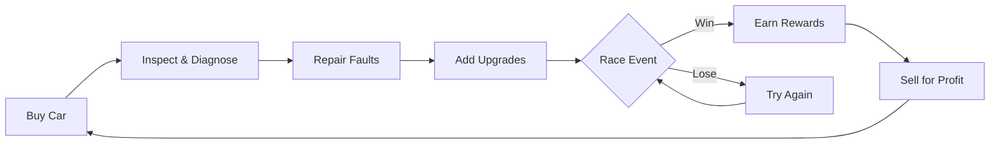

# 🚗💨 Shitbox Workshop

<div align="center">

**Buy questionable used cars. Fix them up. Race them. Sell them. Repeat.**

*A browser-based used-car trading and racing game set in a fictional Malaysian used-car scene*

[](#play-now)
[](LICENSE)
[](https://reactjs.org)
[](https://www.typescriptlang.org)
[](https://phaser.io)

</div>

---

## 🎮 About the Game

Welcome to **Shitbox Workshop**, where you navigate the wild world of Malaysian used cars! Start with RM5,000 and a dream, buy questionable vehicles from colorful sellers, diagnose hidden problems, repair and upgrade them, then hit the autocross circuit to prove their worth.

### 🌟 Features

- 🚙 **5 Unique Car Models** - From nimble hatchbacks to modified MPVs
- 🔧 **Deep Repair System** - 5 fault types, 10 upgrades
- 🏁 **Arcade Racing** - Top-down autocross with drift physics
- 💰 **Economic Strategy** - Buy low, fix, race, sell high
- 🌧️ **Dynamic Events** - Rain affects grip, random lowball offers
- 💾 **Auto-Save** - Progress saved to localStorage
- 📱 **Mobile Support** - Touch controls included

---

## 🚀 Quick Start

### Play Now (No Installation Required)

```bash
# Clone the repository
git clone https://github.com/YapZhuSheng/shitbox-workshop.git
cd shitbox-workshop

# Install dependencies
npm install

# Start development server
npm run dev
```

Then open **http://localhost:5173** in your browser!

### Build for Production

```bash
npm run build
# Built files are in the dist/ directory
# Serve with any static file server
```

---

## 🎯 Gameplay Guide

### 📍 The Loop



### 💵 Starting Out

You begin with **RM5,000**. Here's your strategy:

1. **Browse the Marketplace** - Look for deals on Kancils, Sagas, or Alzas
2. **Inspect Before Buying** - Basic inspection is free, full mechanical inspection costs RM150
3. **Check the Seller's Claims** - "Lady owner, one owner only" might be true... or not
4. **Buy Smart** - Some cars are bargains, others are money pits

### 🔧 Repairs & Upgrades

| Repair | Cost | Effect |
|--------|------|--------|
| 🛞 Replacement Tyres | RM400 | Restores full grip |
| 🛑 Brake Service | RM500 | Restores braking power |
| ⚙️ Gearbox Repair | RM1,200 | No more slipping |
| 🌡️ Cooling System | RM600 | Engine stays cool |
| 🔩 Suspension Repair | RM700 | Stable cornering |

**Performance Upgrades** (requires corresponding repair first):

| Upgrade | Cost | Effect | Tradeoff |
|---------|------|--------|----------|
| 🏎️ Performance Tyres | RM900 | +20% grip | Wear faster |
| 🚨 Upgraded Brakes | RM1,100 | +25% braking | Heavier |
| 🎛️ Sport Suspension | RM1,400 | +25% handling | Harsher ride |
| 🔥 Engine Tune | RM1,800 | +20% power | Runs hotter |
| 🪶 Weight Reduction | RM1,500 | -120kg | Noisy, stripped |

### 🏁 Racing

**KL Autocross Challenge**
- Entry fee: RM100
- 7 checkpoints in order
- Beat the times to earn rewards:

| Medal | Time Target | Reward |
|-------|-------------|--------|
| 🥉 Bronze | Under 65s | RM200 |
| 🥈 Silver | Under 50s | RM400 |
| 🥇 Gold | Under 40s | RM700 |

**Free Practice** - No entry fee, no rewards. Perfect for learning the track!

---

## 🎮 Controls

### Keyboard

| Key | Action |
|-----|--------|
| `W` / `↑` | Accelerate |
| `S` / `↓` | Brake / Reverse |
| `A` / `←` | Steer Left |
| `D` / `→` | Steer Right |
| `Space` | Handbrake (drift!) |
| `Esc` | Pause |
| `R` | Restart lap |

### Mobile

Touch controls appear automatically on mobile devices:
- **L/R** - Steering
- **G** - Gas
- **B** - Brake
- **HB** - Handbrake

---

## 🚗 The Cars

### 🚙 Perodua Kancil 660 EZ
*The People's Champion*
- **Type:** Hatchback
- **Weight:** 720 kg
- **Power:** 31 hp
- **Base Price:** ~RM4,500
- **Character:** Nimble, lightweight, perfect for learning

### 🚗 Proton Saga 1.3 Standard
*The Reliable Workhorse*
- **Type:** Sedan
- **Weight:** 1,050 kg
- **Power:** 70 hp
- **Base Price:** ~RM7,000
- **Character:** Balanced, good all-rounder

### 🚘 Proton Preve 1.6 Turbo Executive
*The Boss Mobile*
- **Type:** Executive Sedan
- **Weight:** 1,380 kg
- **Power:** 138 hp
- **Base Price:** ~RM15,000
- **Character:** Powerful but heavy, demands skill

### 🏎️ Proton Waja 1.6 CPS
*The Enthusiast's Choice*
- **Type:** Coupe (RWD)
- **Weight:** 1,150 kg
- **Power:** 110 hp
- **Base Price:** ~RM8,500
- **Character:** Old-school RWD, drift king potential

### 🚐 Perodua Alza 1.5 AV (Modified)
*The Family Rocket*
- **Type:** MPV
- **Weight:** 1,200 kg
- **Power:** 95 hp
- **Base Price:** ~RM6,000
- **Character:** Questionable modifications, unique character

---

## 🏗️ Tech Stack

- **React 19** - UI framework
- **TypeScript 5.8** - Type safety
- **Vite** - Lightning-fast build tool
- **Phaser 3** - 2D game engine for driving
- **localStorage** - Save system

---

## 🎨 Visual Design

The game features a **night-time workshop aesthetic**:
- Charcoal backgrounds
- Warm cream typography
- Orange accents
- Teal highlights
- Original SVG car illustrations
- Procedurally generated track with trees, barriers, and buildings

---

## 🌧️ Random Events

### Sudden Rain
- Reduces track grip
- Makes drifting easier (and harder to control)
- Visual rain effect on screen

### Lowball Offers
- Random buyers offer below-market prices
- Tempting when you need quick cash
- But is it worth it?

---

## 💡 Tips & Tricks

1. **Start with a Kancil or Alza** - They're cheap and forgiving
2. **Always inspect before buying** - RM150 can save you thousands
3. **Fix critical faults first** - Cooling and gearbox are expensive if ignored
4. **Practice before racing** - Learn the track in free practice
5. **Upgrade strategically** - Tyres and brakes give the best value
6. **Watch the temperature** - If your engine overheats, you'll lose power
7. **Use the handbrake** - Essential for tight corners
8. **Sell at the right time** - Good condition + upgrades = better price

---

## 🐛 Known Limitations

- Driving physics could use more tuning
- Only one track layout (for now!)
- No sound effects or music
- No multiplayer or leaderboard
- Mobile controls could be more responsive

---

## 🤝 Contributing

Contributions are welcome! Feel free to:
- Report bugs
- Suggest features
- Submit pull requests
- Improve documentation

---

## 📄 License

This project is open source and available under the [MIT License](LICENSE).

---

## 🙏 Acknowledgments

- Inspired by Malaysian used-car culture
- Built with React, TypeScript, and Phaser 3
- All car names and descriptions are fictional

---

<div align="center">

**Ready to start your shitbox empire?**

```bash
git clone https://github.com/YapZhuSheng/shitbox-workshop.git
cd shitbox-workshop
npm install
npm run dev
```

*Good luck, and may your gearbox never slip!* 🏁

</div>
